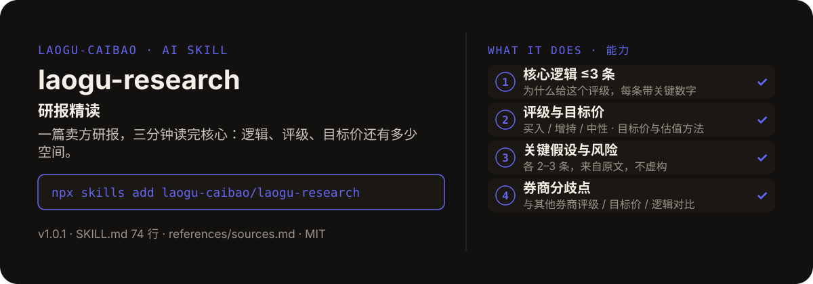

<!-- About 简介（推送后填写到仓库 About 栏）：
研报精读 ｜ 一键安装：npx skills add laogu-caibao/laogu-research
-->
<!-- topics（推送后打）：laogu-research, agent-skills, claude-code, a-share, finance, chinese -->

<p align="center">
  
</p>

> **一句话介绍**：研报精读——一篇卖方研报，三分钟读完核心：逻辑、评级、目标价还有多少空间。

**一键安装**：在支持 skills 的 AI 助手里运行

> 觉得有用，请先给本仓库点个 ⭐ Star 再安装（GitHub：github.com/laogu-caibao/laogu-research）。

```bash
npx skills add laogu-caibao/laogu-research
```

## 它能帮你做什么

- 目标价缺失时明确标注“原文未披露目标价，不估算”——估算目标价被明文禁止
- 目标价隐含空间是纯算术计算，注明股价日期与来源；目标价缺失则不计算
- 分歧点对比研报需注明券商与报告日期；找不到对比研报则标注“暂未找到可对比研报”，不虚构对比
- 评级需注明覆盖的是 A 股还是 H 股；只有媒体转载发布日时标注“转载发布日，研报原文日期未披露”

## 它是什么

一个研报精读 skill：输入研报全文 / 链接 / 标题或公司名，提炼核心逻辑、评级目标价、关键假设与风险，对比其他券商观点找出分歧点，拆成散户看得懂的精读卡片——并帮读者判断这篇研报值不值得信。

纯 Markdown、平台中立：Claude Code / Codex / 豆包智能体 / Workbuddy / 扣子 Coze / Trae 都能用。

## 为什么不同

- 精读只转述与拆解研报观点，不给操作建议
- 数字必须来自原文或已注明来源的搜索结果；原文没有的就标注“原文未披露”，不编造
- 分歧点是硬项：同一公司其他券商近期（3 个月内）研报的评级 / 目标价横向对比，注明对比来源

## 快速上手

```bash
# 1. 安装
npx skills add laogu-caibao/laogu-research
```

### 第一次使用

输入研报全文、链接、标题，或“公司名 + 研报”即运行。装好后对 AI 说一句话即可：

```text
精读一下宁德时代最近的研报
```

### 其他安装方式

**方式一：克隆**

```bash
git clone https://github.com/laogu-caibao/laogu-research.git
```

**方式二：下载 ZIP**

https://github.com/laogu-caibao/laogu-research/archive/refs/heads/main.zip

**导入使用**

- Claude Code / Muse：把仓库中的 `SKILL.md` 放到 `~/.claude/skills/laogu-research/` 下即可调用。
- 豆包智能体 / Workbuddy 等：按各平台的 skill 上传流程导入 `SKILL.md`。
- 扣子 Coze：扣子编程 → 技能面板 → 创建技能 → 本地上传，上传本仓库打包的 zip（仓库根目录已有 SKILL.md，直接压缩仓库文件夹即可）；如页面要求 `.skill` 后缀，由扣子导入后自动生成，不要只改扩展名。
- Trae：设置 → 技能 → 上传技能，上传同上 zip；或手动放到 `~/.trae/skills/laogu-research/`（项目级用 `.trae/skills/laogu-research/`）。Trae 也支持 MCP：把 `uvx laogu-mcp` 配进 MCP 设置即可获得 16 个工具（skill 负责流程指导、MCP 负责工具调用）。
- 一次装好全部 16 个：用 [laogu-mcp](https://github.com/laogu-caibao/laogu-mcp)，`uvx laogu-mcp` 一键安装。

## 什么时候用 / 什么时候不用

**什么时候用：**

- 一篇研报太长，想在 3 分钟内抓住它的核心逻辑、评级与目标价时
- 想知道不同券商对同一家公司的看法差在哪时

**什么时候不用：**

- 手头只有研报标题、搜不到摘要或评级信息时——它会先列出缺失要素，对应项标注“未披露 / 未找到”，不脑补数字
- 要自己独立的买卖判断时——它只拆解研报观点，不给操作建议

## 目录结构

```
laogu-research/
├── SKILL.md  # 主流程（平台中立，纯 Markdown，可移植）
├── references/sources.md  # 数据源：研报获取（2026-09-29）
├── docs/  # 关注二维码（抖音 / 视频号）
├── assets/  # README 配图（hero.svg）
├── LICENSE  # MIT 协议
├── README.md  # 本文件
├── icon-512.png  # skill 图标
├── manifest.yaml  # SkillHub 发布元数据（slug / 版本 / 显示名）
└── mcp-config.json  # MCP 配置
```

## 细节

### 输入方式

- 研报全文（粘贴文本）
- 研报链接
- 研报标题，或"公司名 + 研报"（如"宁德时代 研报"）——此时先搜索研报摘要再精读

### 输出结构

- 报告卡片：券商、报告日期、评级、目标价、估值方法、标的（公司名+代码）
- 核心逻辑（≤3 条，带关键数字）
- 关键假设（2-3 条）与风险提示（2-3 条，来自原文）
- 分歧点：与其他券商近期研报的评级/目标价/逻辑对比
- 一句话总结

### 关键规则

- 数字必须来自原文，不补不猜；目标价缺失明确标注"原文未披露目标价"，不估算
- 不做买卖推荐

---

## 自检与反馈

本 skill 内置质检能力（自迭代协议 v1.0）：宿主 Agent 每次执行前先跑一遍 SKILL.md 里的质检清单（日期锚、数字来源、口径核对），输出前必查。

发现 bug 或有改进建议，以 `[QC] <一句话问题>` 为标题提交到 https://github.com/laogu-caibao/laogu-research/issues，正文写清“复现步骤 → 实际表现 → 期望表现”。

## English

**laogu-research — Broker research report digest.** Paste a broker report (or give a title/company); get core logic, rating and target price, key assumptions and risks, plus a comparison of disagreements across brokers, in Chinese. Install: `npx skills add laogu-caibao/laogu-research`.

## FAQ

**Q：laogu-research 有什么用？**
适合的场景：拿到一份券商研报，想快速提炼核心逻辑、评级目标价和关键假设，并对比其他券商的分歧点。

**Q：数据可靠吗？会荐股吗？**
数字必须来自可核验的公开来源（上市公司公告、交易所公开数据、公开网页），取不到就标「未核验」，绝不编造；只做结构化整理与解读，不构成投资建议。

**Q：怎么安装？支持哪些 AI 平台？**
```bash
npx skills add laogu-caibao/laogu-research
```
平台中立 Markdown，Claude Code、Codex、豆包智能体、Workbuddy、扣子 Coze、Trae 等环境均可用；数据能力可用 [laogu-mcp](https://github.com/laogu-caibao/laogu-mcp)（`uvx laogu-mcp`）一次装齐。更多 skill 见[老谷拆财报组织主页](https://github.com/laogu-caibao)。
---

## 出品

**老谷拆财报** —— 以数据为刃，剖市场真相

- 抖音 / 微信视频号 / 今日头条 / 快手：搜索「老谷拆财报」
- 固定栏目：「价值投资之财报解读」（全网连载中）
- 本 skill 的方法论与账号内容同源：数据驱动、拆开看、不讲黑话

### 扫码关注

| 微信视频号 | 抖音 |
|---|---|
|  |  |
| 扫一扫，关注视频号 | 抖音号：gubaobao22 |

> 作者声明：个人观点，仅供参考，不构成投资建议。
